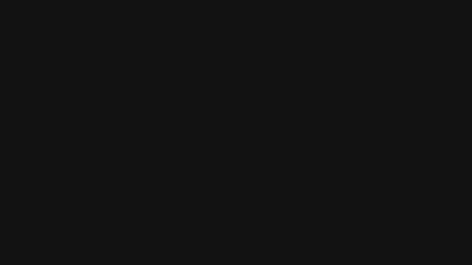

# Strider + effect-bdd

Gherkin scenarios run by [effect-bdd](https://github.com/tatemz/effect-bdd) against
[The Internet](https://the-internet.herokuapp.com), driven by [Strider](https://usestrider.dev) on Chromium. Every
scenario writes a WebM of its run, and a failed one also writes a full-page screenshot.



([the WebM it recorded](docs/enabling-the-text-box.webm))

## Running it

You need Node 22.18 or later, Chrome or Chromium, and ffmpeg on your `PATH`. Strider never downloads a browser, so
point it at one you have: `npx @usestrider/cli browsers` lists the ones on your machine.

```sh
pnpm install
CHROMIUM_PATH="/Applications/Google Chrome.app/Contents/MacOS/Google Chrome" pnpm test
```

```text
Features: 2, Scenarios: 3, passed: 3, failed: 0
Duration: 11275ms
```

The videos are in `artifacts/`, one for each scenario, named after it: `artifacts/logging-in.webm`. If a scenario
fails, `artifacts/logging-in.png` is the page as it was when it failed.

## How it works

| File                                         | What it is                                                                 |
| -------------------------------------------- | -------------------------------------------------------------------------- |
| `features/*.feature`                         | the scenarios, in Gherkin                                                  |
| `features/*.steps.ts`                        | each feature's scenario chains, which effect-bdd pairs with the `.feature` |
| `src/steps.ts`                               | steps the features share: opening a page, clicking, seeing text            |
| `src/scenario-page.ts`                       | `ScenarioPage`, the page a scenario acts on, and the layer that makes it   |
| `src/video.ts`                               | `recordVideo`: Chromium's screencast, encoded as a WebM by ffmpeg          |

Each scenario ends with `Bdd.provide(scenarioPage("logging-in"))`, so effect-bdd builds a browser and page for that
scenario and closes them when it ends, however it ends. Its steps take the page from the `ScenarioPage` service and
pass it along as the scenario's state.

The layer starts the recording as it opens the page. It also adds a finalizer that receives the scenario's `Exit`, so
it can take a screenshot only when the scenario failed. That finalizer runs before the page closes.

Chromium has no video file of its own, only a screencast: a JPEG each time the page repaints. `recordVideo` takes the
latest frame 25 times a second and pipes them to ffmpeg, which reads them at 25 frames a second, so the video keeps
time with the run. When the scenario ends, it records one more second for the last paint and then waits for ffmpeg to
finish the file. On Firefox, Strider's `Capability.Video` writes a WebM itself, without ffmpeg.

## Notes

- Strider gives an expectation up to 30 seconds. With effect-bdd's `--step-timeout` shorter than that, the step
  fails with effect-bdd's timeout before Strider can report what it saw on the page.
- The scenarios visit the live site, so they need a network connection and depend on the site staying up.
